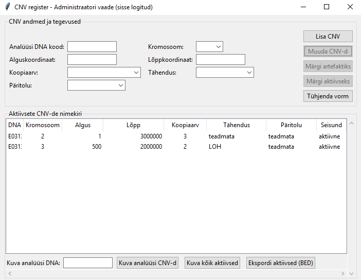

# CNV registry

Desktop application (Python, Tkinter, SQLite) for managing copy number variant (CNV) data.

Goal: a local database of CNVs from Illumina SNP array data, exported as BED.

The user interface is in Estonian; code, database schema and documentation are in English.

## Requirements

*   Python 3.8 or newer (Tkinter and `sqlite3` are included in the standard library)

## Setup and running

### Option 1. Command line

1.  Clone the repository: `git clone https://github.com/kadijairus/cnv_registry_sqlite.git`
2.  **Create the database:** open a terminal in the project folder (on Windows, e.g. type `cmd` in the Explorer address bar) and run:
    ```bash
    python cnv_registry_db.py
    ```
    *   Creates `cnv_registry.db` on the local disk (`C:\Users\<user>\cnv_registry\`).
    *   `Registrid_cleaned.sql` contains the schema and a small amount of demo data.
    *   If the database already exists, you are asked to confirm (`YES`) and a backup is made before it is overwritten.
3.  **Start the application:**
    ```bash
    python cnv_admin_gui.py
    ```



### Option 2. PyCharm

1.  File → Project from Version Control → URL: `https://github.com/kadijairus/cnv_registry_sqlite.git`
2.  Run `cnv_registry_db.py` first, then `cnv_admin_gui.py`.

## Usage

*   View CNVs by DNA code, add and edit CNVs, mark them as active or artefact.
*   Export active CNVs as a BED file (GRCh38).

## Notes

*   **Resetting the database:** to start over, run `python cnv_registry_db.py`. The existing `cnv_registry.db` is deleted after confirmation and a backup, and then rebuilt.
*   **Backups:** `cnv_backup.py` makes a verified backup in `U:\cnv_registry_backups` (change `BACKUP_DIR` in the file).
    *   Automatically: once a day when the application is closed, and before the database is overwritten.
    *   Manually: `python cnv_backup.py`.
    *   The 30 most recent backups and the first backup of each month are kept.
*   **Version control:** databases, Excel and BED files are excluded from git by `.gitignore` – patient data does not go into git.
*   **Browsing the database (optional):** the contents of `cnv_registry.db` can be viewed with any SQLite browser (e.g. DB Browser for SQLite).
